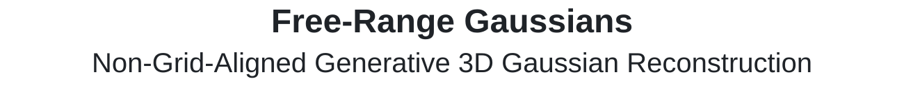

<p align="center">
  <picture>
    <source media="(prefers-color-scheme: dark)" srcset="assets/title-dark.svg">
    
  </picture>
  <br>
  <a href="https://ahanio.github.io/">Ahan Shabanov</a> · <a href="https://phogzone.com/">Peter Hedman</a> · <a href="https://ethanweber.me/">Ethan Weber</a> · <a href="https://sites.google.com/view/zhengqinli">Zhengqin Li</a> · <a href="https://rozumden.github.io/">Denis Rozumny</a> · <a href="https://scholar.google.com/citations?hl=fr&amp;user=QrIyt6sAAAAJ&amp;view_op=list_works&amp;sortby=pubdate">Gael Le Lan</a> · <a href="https://scholar.google.com/citations?user=QNwhaR8AAAAJ&amp;hl=en">Naina Dhingra</a><br>
  <a href="https://scholar.google.com/citations?hl=en&amp;user=CKCjNG4AAAAJ&amp;view_op=list_works&amp;sortby=pubdate">Lei Luo</a> · <a href="https://www.robots.ox.ac.uk/~vedaldi/">Andrea Vedaldi</a> · <a href="https://richardt.name/">Christian Richardt</a> · <a href="https://taiya.github.io/">Andrea Tagliasacchi</a> · <a href="https://scholar.google.com/citations?user=GwGsvm0AAAAJ&amp;hl=en">Bo Zhu</a> · <a href="https://nkhan2.github.io/">Numair Khan</a><br>
  <sub>Meta Reality Labs · Simon Fraser University · University of Oxford · University of Toronto</sub>
</p>

<p align="center">
  <a href="https://arxiv.org/abs/2604.04874"></a>
  <a href="https://free-range-gaussians.github.io"></a>
  <a href="https://huggingface.co/facebook/free-range-gaussians"></a>
  <a href="LICENSE"></a>
  <a href="MODEL_LICENSE"></a><br>
  <strong><a href="#quick-start">Quick start</a> · <a href="#inference">Inference</a> · <a href="#license">License</a> · <a href="#citation">Citation</a></strong>
</p>

https://github.com/user-attachments/assets/4024a8e7-1d7a-445f-a255-144225b01d42

## Quick start

**Requirements:** Linux, Python 3.10–3.12, and an NVIDIA CUDA GPU.

### 1. Install

```bash
python -m venv .venv
source .venv/bin/activate
pip install -r requirements.txt
pip install -e .
```

### 2. Download the checkpoint

Request access on [Hugging Face](https://huggingface.co/facebook/free-range-gaussians).
After approval, authenticate with the same account and download the weights
from this code checkout:

```bash
hf auth login
hf download facebook/free-range-gaussians frg_ckpt.pt --local-dir checkpoint
```

The inference checkpoint is loaded from `checkpoint/frg_ckpt.pt`.
See [checkpoint details and checksum](checkpoint/README.md).

## Inference

Run a bundled example:

```bash
bash run_example.sh TOWER_TUMBLING nc4
```

Results are saved to `outputs/TOWER_TUMBLING_nc4/`:

- `reconstruction.ply` — the reconstructed Gaussian splats.
- `showcase.png` — reference views and matching model predictions.
- `run.json` — settings, checkpoint checksum, software versions, and timing.

The [five bundled examples](examples/) support `nc1` (one camera cluster) and
`nc4` (views from four camera clusters).

### Your own scene

Use a [scene JSON](examples/TOWER_TUMBLING/scene_nc4.json) as a template. Provide
exactly four 512×512 posed inputs, camera intrinsics, and OpenCV world-to-camera matrices
(or their inverses). Image paths are relative to the JSON file.

```bash
python -m free_range_gs.infer --scene path/to/scene.json --output-dir outputs/my_scene
```

See [usage notes](docs/USAGE.md) for scene calibration, CPU validation, offline
loading, and photometric guidance. Agents should follow [AGENTS.md](AGENTS.md).

## License

- **Code:** [MIT](LICENSE).
- **Free-Range Gaussians weights and outputs:** [FAIR Noncommercial Research License](MODEL_LICENSE),
  including the FAIR Acceptable Use Policy; noncommercial research use only.
- **DINOv2 encoder:** retains its upstream [Apache 2.0 license](THIRD_PARTY_NOTICES.md#apache-license-20).

**Dependency notice:** PLY export uses [`plyfile`](https://github.com/dranjan/python-plyfile),
which is licensed under **GPLv3 or later**. The project’s MIT license does not
replace that license.

## Citation

If you use this work in your research, please cite the ECCV 2026 paper.

<details>
<summary>BibTeX</summary>

```bibtex
@inproceedings{shabanov2026freerange,
  title   = {Free-Range Gaussians: Non-Grid-Aligned Generative 3D Gaussian Reconstruction},
  author  = {Shabanov, Ahan and Hedman, Peter and Weber, Ethan and Li, Zhengqin and
             Rozumny, Denis and Le Lan, Gael and Dhingra, Naina and Luo, Lei and
             Vedaldi, Andrea and Richardt, Christian and Tagliasacchi, Andrea and
             Zhu, Bo and Khan, Numair},
  booktitle = {European Conference on Computer Vision (ECCV)},
  year    = {2026}
}
```

</details>
